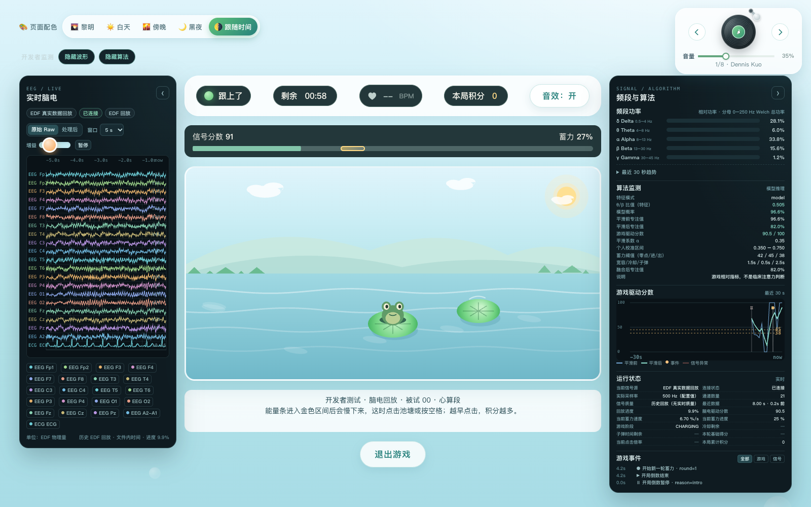
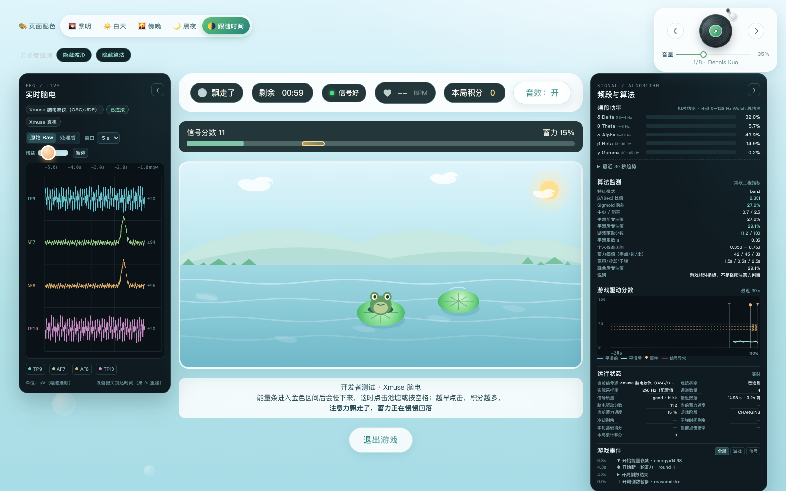
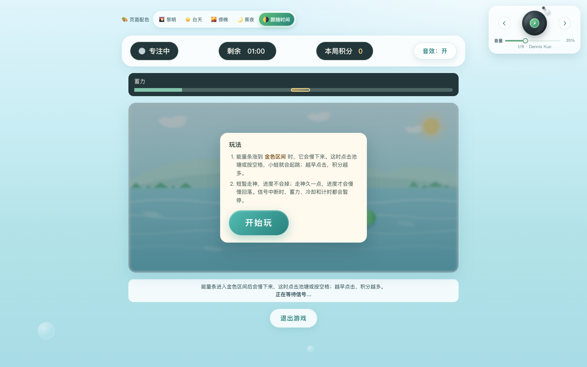

# 开发报告：实时脑电监测工作台（v1.7.0）

> 日期：2026-11-27
> 仓库：`https://github.com/mujiu07/eeg-focus`
> 目标：在开发者模式三栏工作台中展示「脑电采集 → 信号处理 → 特征提取 → 分数映射 → 游戏反馈」，不修改 v1.6.0 的核心玩法、蓄力算法、计分与儿童模式规则。

## 1. 交付摘要

- 开发者模式新增左/中/右三栏布局：左侧多通道波形，中间原游戏，右侧频段、算法、分数、事件与运行状态。
- 波形只使用真实窗口：硬件原始窗在去噪前复制，处理后窗直接读取 `FocusEngine.last_debug["processed"]`；EDF 回放显示真实历史数据；手动/仅心率明确显示无脑电采样，不生成随机或正弦曲线。
- 新增独立高频监测 SSE：`GET /api/session/{sid}/monitor`。游戏控制 SSE 不变；只有开发者订阅时才构造监测批次。
- 儿童模式：不创建 `EEGMonitor`，`/monitor` 请求数为 0，面板完全隐藏；原有游戏视觉与操作保持。
- 新增 `tests/selfcheck_monitor.py` 9 项数据一致性检查；原有 36 项单轮回归、10 项静态 UI 检查、14 项去噪回归继续通过。

## 2. 实际修改文件

| 文件 | 修改 |
|---|---|
| `app/features.py` | 新增 `window_to_feature_details()`，一次 PSD 同时返回特征和 powers/relative/ratio；`window_to_features()` 复用同一结果，算法值不变 |
| `app/focus_engine.py` | 保存 `last_debug`：实际 `processed`、powers、relative、ratio、概率/频段映射、raw/smooth、EMA |
| `app/xmuse_osc.py` | 在接收线程内记录逐样本时间/序号与窗口快照，避免缓冲区覆盖后监测时间错位 |
| `app/sources.py` | 在 `ArtifactCleaner` 之前复制硬件原始窗；EDF 保存原始窗与文件内采样时间；统一 `take_monitor_window()` |
| `app/monitor.py` | 新增监测批次序列化、频段行、算法字段、单位标注、相对功率分母说明 |
| `app/server.py` | 版本 1.7.0；Session 监测队列/独立事件；`/api/session/{sid}/monitor`；游戏 SSE 增加 `score_raw`/`score_smooth`；监测异常不影响游戏 |
| `web/game.html` | 三栏 DOM、开发者 `?dev=1`、监测初始化、游戏事件埋点、`getState/getRound` 接线、监测停止 |
| `web/assets/eeg-monitor.js` | 新增 Canvas 波形/频段/分数、环形缓存、事件标记、状态面板、暂停/窗口/增益/通道/折叠、断流与缺号处理 |
| `web/assets/eeg-monitor.css` | 深色监测面板、三栏/响应式/折叠样式 |
| `web/dev.html` | 新增「脑电实时工作台」入口 |
| `web/assets/eeg-monitor` 测试 | `tests/selfcheck_ui_static.js` 扩展到 10 项；新增 `tests/selfcheck_monitor.py` 9 项 |
| `docs/` | 本报告、README、CHANGELOG、ARCHITECTURE、TECH-DESIGN、usage-and-privacy |

## 3. 界面与截图

### 3.1 EDF 回放（真实历史 21 通道）



- 左：21 个真实 EDF 通道，5 s 窗口，独立通道道、统一时间轴、每道自适应振幅与通道显隐。
- 中：原游戏画面；三栏不遮挡游戏，中央保持原宽高比。
- 右：真实相对频段功率、模型推理中间值、30 s 分数曲线、事件和状态。

### 3.2 合成 OSC 验收（不是真机）



> 此截图来自 `scripts/mock_osc_feed.py` 的合成 4 通道流，用于验证无 Xmuse 时的原始/处理后、眨眼修复、质量与算法链路。它不是人体脑电，也不是真机验证。

### 3.3 儿童模式



儿童模式下三个监测面板均 `display:none`，顶部无监测开关，`/monitor` 请求数为 0；HUD 不显示实时脑电分/百分比/BPM/质量。

## 4. 实时数据流

```text
Xmuse OSC/UDP（4/6 ch，2 s 窗，0.5 s 步长）
  → xmuse_osc.py 接收线程：样本缓冲 + 逐样本序号/到达时间快照
  → sources.HardwareSource：去噪前复制 raw
  → ArtifactCleaner：去趋势/陷波/眨眼/削顶/坏道/质量
  → FocusEngine：实际带通 + 特征 + 映射 + EMA
  → Session：游戏分数 SSE（0.5 s）
  → Session._publish_monitor（仅 /monitor 有订阅者）
  → /api/session/{sid}/monitor（独立 SSE）
  → eeg-monitor.js：有界缓存 → Canvas
```

- `raw`：硬件在清洗前复制；EDF 从真实文件窗口复制。
- `processed`：`FocusEngine.last_debug["processed"]`，就是模型/频段指标实际使用的带通后窗口，不额外创建滤波。
- `bands/ratio`：同一 `last_debug` 的 powers/relative/ratio，不在前端重算。
- `score_raw/score_smooth`：都使用 `Session.score_of()` 同一映射；游戏主分数仍由原 `/stream` 驱动。
- 原始/处理后共享 `sample_seq0/1`、`t0/t1`、`fs`；客户端按样本序号去重，缺号画灰带，不补 0。

### 4.1 时间口径

| 来源 | 字段 | 说明 |
|---|---|---|
| Xmuse | `time_basis="device_packet_arrival"` | OSC 不提供逐样本硬件时间戳；按报文到达时间终点和配置 `fs` 重建，面板明确提示 |
| EDF | `time_basis="edf_file"` | 文件内采样时间；持续标注“历史 EDF 回放”与进度 |
| 游戏事件 | `event.t` | 最近一帧后端 `t` + `performance.now()` 帧间增量，不用浏览器收到 SSE 的时间冒充采样时间 |
| 数据年龄 | 状态栏 | 浏览器收到批次后的年龄，仅用于新鲜度提示 |

### 4.2 单位与采样率

- Xmuse OSC 单位不由协议保证；`denoise` 按幅值稳健推断，面板显示 **“µV（幅值推断）”** 或 **“设备原始单位”**，不把未确认值强行标为 µV。
- EDF 显示 **“EDF 物理量”**；不将回放标为当前采集。
- Xmuse 的 `256 Hz` 是配置值，状态栏明确写“配置值”，不是实测采样率。
- 现有相对功率分母是 **同一窗 Welch PSD 全频段总功率（0–Nyquist）**；面板显示实际分母，不写成 0.5–45 Hz。

## 5. 接口与字段

`GET /api/session/{sid}/monitor`（SSE）：

- `hello`：`available`、`source`、`fs`、`ch_names`、`sample_rate_note`、`time_basis`
- `monitor`：`seq`、`source_name`、`fs`、`ch_names`、`channels[{name,ok}]`、`unit`、`unit_confidence`、`sample_seq0/1`、`t0/t1`、`n`、`raw`、`processed`、`quality`、`bands`、`relative_power`、`algorithm`、`replay`
- `unavailable`：手动/仅心率等无脑电模式
- `end`：会话结束

`algorithm` 字段：`mode`、`relative`、`powers`、`ratio`、`sigmoid`/`probability`、`band_focus`、`raw_focus`、`smooth_focus`、`ema_alpha`、`game_score`、`fused_focus`、`baseline`、`score_range`。

游戏 `/stream` 新增：`score_raw`、`score_smooth`，与原 `score` 共用映射。

## 6. 模式支持

| 模式 | 状态 |
|---|---|
| EDF 回放 | **已实现并验证**：真实历史 21 通道、文件内时间、回放进度、历史标签 |
| 手动试玩 | **已实现**：有游戏分数曲线/状态/事件；波形与频段显示“当前模式无脑电采样数据” |
| 仅心率 | **已实现接口与隔离**：不伪造 EEG，显示真实心率驱动分数；未做硬件心率本轮机测 |
| Xmuse 真机 | **接口与链路已实现，但真机验证未完成**；无设备时使用合成 OSC 验证，不把结果称为真机 |

## 7. 测试结果

```bash
node tests/selfcheck_round_logic.js     # all 36 checks passed
node tests/selfcheck_ui_static.js       # all 10 static UI checks passed
node tests/score_distribution.js        # DIST_OK
python tests/selfcheck_monitor.py       # all 9 monitor checks passed
python tests/selfcheck_score_mapping.py # all checks passed
python tests/selfcheck_denoise.py       # 14/14 passed
python -m py_compile app/server.py app/export.py app/focus_engine.py \
  app/features.py app/monitor.py app/xmuse_osc.py app/sources.py
```

### 7.1 数据一致性

- `window_to_features()` 与 `window_to_feature_details()` 特征向量逐值相等。
- `FocusEngine.last_debug["processed"]` 与 `features.prepare_signal()` 同一输入逐值相等；powers/total 与同一窗 `band_power()` 相等。
- EDF `take_monitor_window()["raw"]` 与 `next_window()` 原始 `seg` 相等。
- OSC 窗口 `seq1-seq0+1 == n`，`t1-t0 == (n-1)/fs`（合成测试）。
- `build_batch(raw=None, processed=None)` 明确输出 `raw=None/processed=None`，算法 `available=false`，不产生曲线。

### 7.2 浏览器功能验证

- 开发者模式三栏布局：EDF 21 ch / 合成 4 ch 均正常。
- 原始/处理后切换：Canvas 像素内容变化，数据源来自两个真实字段。
- 2/5/10 s 窗口、增益、通道显隐、折叠/恢复：均正常。
- 暂停波形：Canvas 冻结，游戏计时继续（00:59 → 00:57）。
- 儿童模式：`monitor-mode=false`，三个面板 `display:none`，`/monitor` 请求 `[]`，`debug-hud=false`。
- 断流/质量：合成 OSC 中眨眼可显示 `blink` 质量；监测断流时保留历史并显示“数据已停止更新”。
- 控制台仅有既有 `favicon.ico` 404；无 JS 异常。

### 7.3 性能（本机 macOS，Edge headless，1600×1000）

| 场景 | FPS | 8 s TaskDuration 增量 | 8 s ScriptDuration 增量 | 备注 |
|---|---:|---:|---:|---|
| 4 ch 合成 OSC，监测可见 | 60.0 | 0.87 s | 0.25 s | 4 通道 5 s |
| 4 ch 合成 OSC，两侧收起 | 60.0 | 0.75 s | 0.21 s | 收起后减少绘制 |
| EDF 21 ch 500 Hz，监测可见 | 60.1 | 1.39 s | 0.85 s | 21 通道 5 s；单批 JSON 约 0.36 MB |
| EDF 21 ch 500 Hz，两侧收起 | 60.0 | 0.69 s | 0.23 s | 隐藏面板后停止绘制，任务时间明显下降 |

> `TaskDuration` 是浏览器主线程累计任务时间，不是整机 CPU；表中为 8 s 窗口增量。监测绘制使用 Canvas 2D，未在采样点到达时逐点重建 DOM。

### 7.4 30 分钟稳定性

运行：4 通道合成 OSC 压力流（`scripts/mock_osc_feed.py`，**不是真机**）+ 开发者游戏页 `sec=1800`，监测面板保持可见；Edge headless 1600×1000。

| 时间 | FPS | JS 堆 | DOM 节点 | JS 监听器 | `/monitor` 请求 | 事件数 | 流状态 |
|---:|---:|---:|---:|---:|---:|---:|---|
| 5 min | 60.0 | 10.9 MB | 1740 | 67 | 1 | 10 | 已连接 |
| 10 min | 60.0 | 9.8 MB | 1621 | 80 | 1 | 10 | 已连接 |
| 15 min | 60.0 | 7.3 MB | 1396 | 80 | 1 | 10 | 已连接 |
| 20 min | 60.0 | 12.2 MB | 1839 | 80 | 1 | 10 | 已连接 |
| 25 min | 60.0 | 9.9 MB | 1760 | 80 | 1 | 10 | 已连接 |
| 30 min | 60.0 | 9.3 MB | 1657 | 80 | 1 | 10 | 已连接 |

结论：
- 浏览器帧率稳定 60 FPS，JS 堆在 7.3–12.2 MB 间回收，DOM 节点没有单调增长，监听器在 10 min 后稳定在 80，`/monitor` 只建立 1 条连接；没有重复订阅或连接泄漏。
- 事件列表/波形缓存保持有界（事件稳定 10 条；30 min 页面未点击，游戏事件本身不增加）。
- 服务端进程 RSS 在该轮结束为 **411 MB**，但该进程此前保留了本机多次 EDF 21 ch 测试会话（`/api/dev/info` 可查到 10 个已完成但仍驻留内存的 Session，EDF 源持有整段数据）；这不是监测队列的增长。监测队列固定上限 12 批。**未来应给已完成 Session 增加 TTL/清理**，本轮未为此扩大改动范围。重新启动服务后的单会话基线未单独测量，不能把 411 MB 全部归因于监测。
- 该测试的环境是合成 OSC，不代表 Xmuse 真机、儿童或低端平板结果。

## 8. 尚未解决的问题

1. **没有 Xmuse 真机**：真机通道/单位/质量/固件差异未验证；合成 OSC 只能证明链路，不可当人体脑电或临床数据。
2. **没有儿童受试者**：儿童模式只做了 DOM/订阅隔离与原有玩法回归，未做儿童可用性试验。
3. **监测传输未压缩**：21 ch EDF 每批约 0.36 MB，0.5 s 一批；本地开发可接受，但 10 s 窗口/低端设备需要后续做解码或降采样传输优化。
4. **监测节拍**：现有信号源 0.5 s 一窗，监测沿用 0.5 s 批次；不是 100–200 ms。显示 30 FPS 不代表采样率。
5. **侧栏内部滚动**：桌面大屏完整显示；窄窗口默认收起两侧面板，展开后可能需要面板内滚动。未做独立浮层/全屏监测模式。
6. **无主动暂停按钮**：事件模型支持 `game_pause/game_resume`，当前只有开局倒数/教学和信号异常会触发暂停；儿童端仍无“暂停游戏”控件。
7. **仅心率模式**：监测接口明确不可用 EEG；未在本机做 AirPods 心率真机监测验证。

## 9. 主要技术决策

| 决策 | 原因 |
|---|---|
| 独立 `/monitor` SSE，不改游戏 `/stream` | 高频波形不能阻塞控制帧；复用现有 SSE/FastAPI，不引入 WebSocket |
| 原始窗在 `sources` 复制，processed 从 `FocusEngine` 读 | 保证“原始”确实在软件处理前，“处理后”确实是被算法使用的数据 |
| 不新增前端滤波 | 避免展示波形与算法输入不一致 |
| 仅开发者订阅时构造批次 | 儿童模式零高频序列化、零高频网络订阅 |
| 硬件缺省单位不强标 µV | OSC 协议不保证单位；按幅值推断并标注可信度 |
| EDF 明确历史标签/文件内时间 | 不把回放数据伪装成当前采集 |
| 画布固定 0–100 分纵轴 | 避免自动缩放造成“分数剧烈变化”的误读 |
| 事件时间取后端帧时间 + 帧间增量 | 不把浏览器到达时间当成采样时间 |
| 原始窗只在内存有限队列 | 生理数据最小化，不新增默认持久化 |

## 10. 复现

```bash
cd eeg-focus
.venv/bin/python -m uvicorn app.server:app --host 127.0.0.1 --port 8000

# EDF 回放（开发者测试校准后）
open 'http://127.0.0.1:8000/game.html?test=replay&sec=60'

# Xmuse / 合成 OSC
.venv/bin/python scripts/mock_osc_feed.py --port 7000 --seconds 60
open 'http://127.0.0.1:8000/game.html?dev=1&sec=60'
```

> `?dev=1` 使用上一次校准的信号源；真机需先在开发者页应用 Xmuse 并完成校准。无 Xmuse 时合成 OSC 只用于验收，报告中不得写成真机结果。
